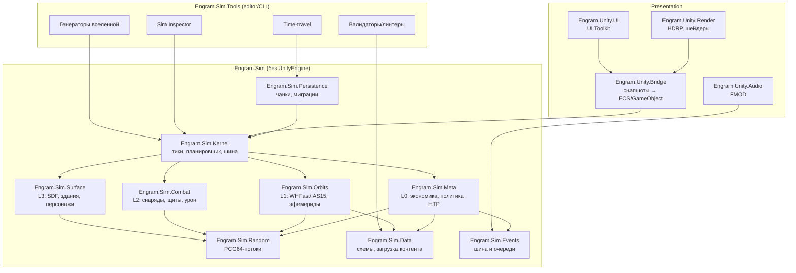

# 03. Архитектура

> **Статус:** Draft v0.1 · **Владелец:** Lead Programmer · **Зависит от:** [01. Канон](01-canon.md), [02. Тулчейн](02-toolchain.md) · **Обновлено:** 2026-10-26

## 1. Назначение, границы и инварианты

Документ описывает слои кода, контракты между ними, детерминизм, сохранения, бюджеты и точки подмены. Геймплейные правила — в [04. Симуляция и физика](04-simulation-physics.md) и [05. Корабль](05-ship-crew-progression.md), процессы сборки — в [13. Пайплайн](13-content-pipeline-devops.md).

Пять архитектурных инвариантов, которые нельзя нарушать без ADR:

| # | Инвариант | Проверяется |
|---|---|---|
| I-1 | `Engram.Sim` не ссылается на `UnityEngine` / `Unity.*` ни прямо, ни транзитивно | CI-правило компиляции + анализатор зависимостей сборок |
| I-2 | В симуляции нет `float`, `System.Random`, `DateTime.Now`, `Guid.NewGuid`, зависимости от порядка итерации `Dictionary` | анализаторы Roslyn в CI (запрет типов в namespace `Engram.Sim.*`) |
| I-3 | Один и тот же seed + один и тот же журнал команд + одна сборка = один и тот же golden hash | ночные golden-hash регрессии |
| I-4 | L0 не ждёт L1–L3; нижестоящие уровни включаются и выключаются без потери корректности L0 | тест «L0 без рендера» на headless-раннере |
| I-5 | Любое состояние сохранения сериализуется канонически (стабильный порядок полей и коллекций) | тест схемы + хэш сохранения |

## 2. Слои и правила зависимостей

### 2.1 Три слоя

```text
┌──────────────────────────────────────────────────────────────┐
│ PRESENTATION (Unity, HDRP, GameObject/ECS-визуал, UI, аудио) │
│  чтение состояния через снапшоты; команды — через шину       │
└───────────────▲───────────────────────────┬──────────────────┘
                │ снапшоты/события           │ команды (intent)
┌───────────────┴───────────────────────────▼──────────────────┐
│ SIMCORE: Engram.Sim (net8.0 / netstandard2.1, БЕЗ UnityEngine)│
│  L0 мета · L1 орбиты · L2 бой · L3 поверхность · правила мира│
└───────────────▲───────────────────────────┬──────────────────┘
                │ данные/схемы               │ отчёты, метрики
┌───────────────┴───────────────────────────▼──────────────────┐
│ TOOLS: Engram.Sim.Tools (только редактор/CLI)                │
│  Sim Inspector · time-travel · валидаторы · генераторы       │
└──────────────────────────────────────────────────────────────┘
```

### 2.2 Матрица допустимых зависимостей

| Из \ В | SimCore | Presentation | Tools | Внешние | UnityEngine |
|---|---|---|---|---|---|
| **SimCore** | да (внутри) | **нет** | нет | только .NET BCL + `Math`/`MemoryPack`-подобные разрешённые | **запрещено** |
| **Presentation** | **да** | да | нет | Unity-пакеты | да |
| **Tools** | **да** | нет | да | редакторные | да (только в `#if UNITY_EDITOR`) |

Правила: зависимость разрешена **только вниз по стрелке**. Presentation знает о SimCore, SimCore о Presentation — нет. Tools знает оба, но не попадает в плеер (assembly definition с флагом `Editor`).

### 2.3 Mermaid-диаграмма модулей



## 3. Модули и границы ответственности

| Модуль | Ответственность | Не делает | Ключевой тип |
|---|---|---|---|
| `Kernel` | порядок тиков, бюджеты, пауза/скорость, журнал команд | не знает правил мира | `ITickScheduler`, `SimTime` |
| `Random` | именованные PCG64-потоки на домен | не «глобальный RNG» | `IRandomStream` |
| `Meta` (L0) | 64 цивилизации, 210 фракций, рынки, НТР, дипломатия, события | не рисует и не звучит | `IMetaModule` |
| `Orbits` (L1) | N-body, эфемериды, столкновения, сверхновые, приливы | не считает урон корпусу | `IOrbitSolver` |
| `Combat` (L2) | снаряды, щиты, подсистемы, обломки | не решает исход войны | `ICombatResolver` |
| `Surface` (L3) | SDF-воксели 0,25 м, граф конструкций, персонажи | не моделирует орбиты | `ISurfaceWorld` |
| `Data` | загрузка/валидация JSON/YAML/CSV по схемам, ID-реестр | не содержит геймплейных правил | `IContentProvider` |
| `Persistence` | чанки, версии схем, миграции, целостность | не решает, что сохранять | `ISaveSection` |
| `Events` | типизированная шина, очереди, порядок доставки | не содержит логики реакции | `IEventBus` |
| `Bridge` | снапшоты SimCore → ECS/GameObject, интерполяция | не меняет состояние мира | `ISimBridge` |
| `Render` | HDRP, шейдеры, VFX, LOD | не владеет истиной о мире | `IRenderFacade` |
| `UI` | экраны, карта, графики, «почему цена выросла» | не считает экономику | `IViewModel` |
| `Audio` | FMOD-события, адаптивная музыка | не синхронизирует время | `IAudioPort` |
| `Tools` | отладка, валидация, генерация | не входит в билд плеера | — |

### 3.1 Ключевые интерфейсы (псевдокод)

```csharp
// Контракт модуля симуляции: детерминированный шаг.
public interface ISimModule {
    string Id { get; }
    int Order { get; }                        // фиксированный порядок, не алфавит
    void Step(in SimContext ctx, long tick);   // без аллокаций, без I/O
    void WriteCanonical(ICanonicalWriter w);   // для golden-hash и сейва
    void ReadCanonical(ICanonicalReader r);
}

public interface IRandomStream {
    ulong NextULong();
    double NextDouble();        // [0,1)
    double Range(double a, double b);
    IRandomStream Fork(ulong label);  // детерминированное порождение подпотока
}

public interface IClock { SimTime Now { get; } int SpeedMultiplier { get; } }
public interface ICommandLog { void Append(in SimCommand cmd); ReadOnlySpan<SimCommand> Since(long tick); }
public interface ISaveSection { string SectionId { get; } int SchemaVersion { get; } void Migrate(int from, int to); }
public interface IModHost { IReadOnlyList<ModDescriptor> Loaded { get; } LoadOrder Order { get; } }
```

## 4. ECS + DOTS: гибридная модель

ECS применяется в Presentation для того, что имеет смысл в тысячах экземпляров (обломки, снаряды, толпа, SDF-чанки), и в L1 для тел. Истина о состоянии мира при этом живёт в SimCore, а не в ECS-мире: ECS — **проекция** снапшота, а не владелец данных.

| Вопрос | Решение |
|---|---|
| Где истина? | В `Engram.Sim` (SoA-массивы структур, индексы стабильны) |
| Как данные попадают в ECS? | снапшот-буферы: double → float с камера-относительным смещением |
| Кто пишет в мир? | только SimCore; Presentation пишет **команды** в очередь ввода |
| Как быть с уникальными объектами? | GameObject/MonoBehaviour (интерьер, ключевые NPC, интерактив) |
| Структурные изменения | пакетно, раз в кадр, через `EntityCommandBuffer` |
| Как избежать «двух истин»? | правило I-3 + CI-тест «после 10 000 тиков ECS-проекция согласована со снапшотом» |

## 5. Детерминизм

Канон (раздел 17) требует: фиксированный тик, отдельные PCG64-потоки на домен, golden-hash регрессии, воспроизводимость **в пределах одной платформы и сборки**. Архитектура обеспечивает это следующим набором правил.

### 5.1 Источники недетерминизма и ответ

| Источник | Ответ |
|---|---|
| `float`-арифметика | в SimCore только `double`; `float` — на границе с рендером |
| Различия `Math.Sin/Exp` между платформами | собственные детерминированные реализации в `Engram.Sim.Math` (полиномы/таблицы), сравниваемые побитово |
| `System.Random`, `Guid`, `DateTime.Now` | запрещены анализатором; время — только `SimTime` |
| Порядок обхода `Dictionary`/`HashSet` | запрещены в симуляции; только массивы + стабильная сортировка по `uint id` |
| Параллельные Jobs с записью | симуляция **однопоточна по домену**; параллелизм — только для чистых вычислений, результаты сводятся стабильно |
| Платформенный JIT/AOT | golden hash сравнивается внутри одной платформы+сборки (канон), кросс-платформенное сравнение — только «функционально эквивалентно», не побитово |
| Плавающая точка в SIMD | запрет авто-векторизации в местах, влияющих на хэш (атрибут/анализатор), либо фиксированный порядок суммирования |
| Загрузка контента | одинаковый порядок загрузки модов, одинаковые ID (см. 12–13) |

### 5.2 PCG64-потоки

Один seed вселенной → корень `root = SplitMix64(seed)`. Каждый домен получает собственный независимый поток: `Orbits`, `Meta.Economy`, `Meta.Tech`, `Meta.Politics`, `Combat`, `Surface`, `Events.Narrative`, `Generation.Planets`, `Generation.Flora` и т.д. Поток = функция `(root, domainId, salt)`, а не «следующее число глобального генератора». **Правило:** добавление новой случайности не должно сдвигать уже существующие потоки — иначе все сохранения и golden-hash ломаются. Тест: «старые потоки неизменны при добавлении модуля» — часть ночного прогона.

```text
stream(domain, salt) = PCG64( seed = SplitMix64(root ^ Hash64(domain) ^ salt) )
```

### 5.3 Golden hash

Каждые N тиков (шаг задаёт сценарий; для L1 — 1 000 шагов, [04](04-simulation-physics.md) §17; плюс «конец дня») каноническая сериализация состояния сворачивается в 64-битный хэш (xxHash64). Набор эталонных хэшей — для 12 сценариев × 3 длины (1 день, 1 год, 10 лет) — коммитится в репозиторий. Расхождение выводит: сценарий, тик, модуль, первое расхождение в каноническом порядке. Инструмент бисекции (`eng-sim bisect`) ищет первый отличающийся тик за O(log n) перезапусков.

## 6. Планировщик тиков L0–L3

### 6.1 Модель времени

`SimTime` — целые тики: L0 в днях (86 400 с игрового времени), L1/L2/L3 — в миллитиках своего уровня. Базовое соответствие: 1× = 2 реальные секунды на игровой час, игровые сутки ≈ 48 с реального времени (канон, 7.2). Множители скорости не меняют размер тика — они меняют, сколько тиков разрешается за кадр.

```text
loop frame(realDt):
    budget = frameBudget.sim          // ≈ 4 мс главного потока
    simTime.Advance(realDt * speed)   // накопление в double
    while simTime.HasDueTick() and elapsed < budget:
        due = simTime.NextDueLevels()          // L0/L1/L2/L3 по расписанию
        foreach level in due (порядок L0→L1→L2→L3):
            for m in modules[level] by m.Order:  m.Step(ctx, tick)
        if tick % hashEvery == 0: hash.Record(Canonicalize())
    publishSnapshot(interpolated)
```

### 6.2 Бюджеты и поведение при перегрузке

| Уровень | Шаг | Бюджет | При перегрузке |
|---|---|---|---|
| L0 | 1 игровой день | ≤ 20 мс на 8 ядрах (канон) | «догоняющие» тики батчами, пауза автоматически |
| L1 | адаптивный 0,25–3 600 с | ≤ 6 мс/тик | снижение точности интегратора, не пропуск тиков |
| L2 | 1/60–1/10 с | ≤ 8 мс | фиксированные подшаги, замедление времени |
| L3 | 1/30–1/60 с | ≤ 10 мс | упрощение SDF-обновлений |

**Защита от спирали смерти:** максимум K догоняющих тиков L0 за кадр (K = 8 при 4×, 2 при 40×); при исчерпании — принудительная пауза с уведомлением «симуляция не успевает», запись в телеметрию. Сохранение всегда возможно на границе дня (L0), а не «в середине» — это делает сейвы воспроизводимыми.

## 7. Точность и floating origin

Радиус моделируемой системы — до 200 а.е. (≈ 3·10¹³ м), канон 6.3. `float32` даёт ~7 десятичных знаков: на такой дистанции это ошибка в километры. Отсюда три уровня работы с координатами:

| Слой | Тип | Система координат |
|---|---|---|
| SimCore | `double` (метры, СИ) | галактическая инерциальная, начало — центр галактики или локальный якорь |
| Bridge | `double` → `float` | смещение относительно **камеры** (камера-относительный рендер HDRP) |
| Render | `float` | локальная система рендера, «origin rebase» при удалении > 10 км |

Правила: (1) в SimCore запрещены абсолютные координаты, превышающие 10¹⁴ м при передаче в рендер; (2) позиции передаются парой `(long cellId, float local)`, где cellId — 1 а.е.-ячейка; (3) физика Presentation (Unity Physics) живёт в локальном фрейме и пересоздаёт тела при rebase; (4) скорость света и релятивистские эффекты считаются в double всегда. Для навигации по карте галактики (100 000 св. лет) абсолютные координаты не используются вовсе — только граф узлов и `double`-позиция для отрисовки звёзд.

## 8. Save/load: версионирование и миграции

Требования канона: сохранение ≤ 400 МБ, загрузка ≤ 15 с, инкрементальные чанки.

| Аспект | Решение |
|---|---|
| Единица сохранения | чанк = `ISaveSection` (мир-мета, орбиты, корабль, экипаж, экономика, RNG-состояния, моды, история) |
| Формат | компактный бинарный (MemoryPack-совместимый канонический writer), только стабильные поля; отладочный JSON-режим за флагом |
| Версии | `SaveManifest { formatVersion, schemaVersion per section, buildId, modList, seed, tickCount }` |
| Миграции | цепочка `v_n → v_{n+1}` на секцию, тесты «миграция всех эталонных сейвов» в CI |
| Целостность | xxHash64 на чанк + на манифест; отказ от загрузки с понятным сообщением |
| Атомарность | запись во временный файл → flush → rename; автосейв в ротации 3 слота + один «отчёт дня» |
| Инкрементальность | чанки неизменны, пока их содержимое не изменилось (`dirty`-флаг и `chunkVersion`); дельта-сейв хранит только изменённые чанки |
| Политика | нельзя сохраняться в бою/в середине перехода между уровнями; автосейвы — на границе дня |
| Совместимость с модами | сейв хранит `modList` (id, версия, loadOrder, хэш данных); несовпадение → предупреждение, а не молчаливая порча |

Схема миграций поддерживает **обратную** совместимость в пределах минорных версий и **только вперёд** — в пределах мажорных: сейв из 1.0 не грузится в 0.9. Исключений нет: тест «даунгрейд запрещён» в CI.

## 9. Стриминг миров

| Что | Как | Бюджет |
|---|---|---|
| Галактика (2 500 узлов) | Addressables-группы по 12 регионам ≈ 200 узлов; мета-данные узла — лёгкий JSON | загрузка региона ≤ 1,5 с |
| Система (L1) | bubble радиусом до 200 а.е.; при выходе — «сворачивание» в аналитические элементы | ≤ 500 тел |
| Планета (L3) | тайлы SDF 0,25 м, 4 LOD-слоя, зона миссии 2–8 км² | потоковая подгрузка ≤ 120 МБ |
| Обломки (L2) | пул 5 000 объектов, при переполнении — «сворачивание» в статистический слой | ≤ 24 МБ |
| Текстуры/меши систем | Addressables, выгрузка через 2 системы пути | VRAM ≤ 8 ГБ @1440p |

Правило: **симуляция не ждёт стриминга.** L0 идёт, даже если визуал системы ещё грузится; игрок видит индикатор и не теряет прогресс, а отсутствующий визуал не влияет на хэш.

## 10. Многопоточность и бюджеты

| Поток/пул | Что делает | Бюджет |
|---|---|---|
| Главный поток | L0 командный слой, публикация снапшотов, UI, ввод | ≤ 8 мс/кадр |
| Job System (Burst) | L1 интегратор, L2 баллистика, SDF-обновление, LOD-расчёт | ≤ 6 мс суммарно |
| Симуляционные воркеры | L0 подсистемы (экономика 64 цивилизаций, рынки) — через батчи | ≤ 20 мс на тик, 8 ядер |
| Рендер-поток | HDRP | GPU-bound, ≤ 16,6 мс (60 FPS) |
| Аудио | FMOD | ≤ 6 мс DSP |
| Асинхронная загрузка | Addressables/IO | фоновые приоритеты, ≤ 300 МБ/с с SSD |

Правило: главный поток не аллоцирует в стабильном режиме (нулевой GC-мусор в кадре); тест «GC.Alloc == 0 за 600 кадров» на сцене боя.

## 11. Шина событий

| Свойство | Решение |
|---|---|
| Типизация | структуры-события, `IEventBus.Publish<T>(in T)`; никаких строковых ключей |
| Очереди | `Immediate` (внутри тика, детерминированный порядок) и `Deferred` (к концу тика; гарантированный порядок по `EventOrder`) |
| Детерминизм | события публикуются в порядке модулей (`m.Order`), не в порядке потоков; запись в журнал для replay |
| Доставка | подписка через `IEventHandler<T>`, приоритеты фиксированы; Presentation читает **копию** событий тика |
| Отписка | RAII-подобные токены; утечек нет (тест «события умерших систем не доставляются») |
| Моды | моды подписываются через sandbox-API; их события помечаются `origin = Mod(id)` и не участвуют в golden hash |
| Объёмы | ≤ 20 000 событий за L0-тик; при превышении — агрегация новостей (не отбрасывание молча) |

## 12. Data-driven конфиги и JSON Schema

Все числа геймплея живут в данных: 36 ресурсов, 320 техузлов, 12 типов планет, 6 типов правительств, 10 категорий модулей × 5 тиров и т.д. Источник истины — JSON/YAML в `content/`, CSV — для табличных данных, которые правят геймдизайнеры (рынки, веса).

| Правило | Деталь |
|---|---|
| Схемы | JSON Schema (2020-12) рядом с данными; валидация в редакторе, в CI и в рантайме загрузки |
| ID | стабильные `snake_case`, namespace-префикс (`res.iron`, `tech.sw_drive_3`), реестр ID генерируется, дубликаты — ошибка сборки |
| Ссылки | проверяются линтером; «неразрешённая ссылка» = ошибка CI, не warning |
| Горячая перезагрузка | только в редакторе; в рантайме — перезагрузка чанка с сохранением тика |
| Числа из канона | не дублируются «на память»: генератор проверяет инварианты (2500 узлов, 64 цивилизации, 36 ресурсов, 320 узлов) и падает при расхождении |
| Локализация | только ключи в String Table, текста в данных нет |

## 13. Загрузка модов и порядок загрузки

Порядок (детерминированный, фиксируется в сейве): `core` → `official.addon.*` (по возрастанию) → моды, отсортированные по `(priority ASC, id ASC)`. Зависимости разрешаются до загрузки; цикл в графе — ошибка запуска. Каждый мод объявляет `mod.json`: id, версия, gameVersion, зависимости, priority, переопределяемые ID. Переопределение — только явными override-патчами, не «перезаписью файла»: так работает conflict-report.

Правило: **изменения модов не попадают в golden hash** и не участвуют в зачётных регрессиях — для них отдельный набор тестов совместимости.

## 14. Инструменты отладки

| Инструмент | Что делает | Точка подключения |
|---|---|---|
| Sim Inspector | счётчики сущностей, тайминги модулей, топ-аллокаций, рынки | `ITickScheduler` + `ISimModule` |
| Time-travel | журнал команд + ключевые кадры каждые 100 тиков, откат и пошаговое продолжение | `ICommandLog` + `Persistence` |
| Determinism diff | сравнение прогонов, первый расходящийся тик и сущность | golden-hash набор |
| «Почему цена выросла» | трассировка сделки (Δp/p = −k·Q/V, канон 10) по шагам | `Meta.Economy` |
| Графики экономики | ВВП, инфляция, безработица, дефицит по цивилизациям | телеметрия + L0 |
| Generate & inspect | генерация вселенной по seed с отчётом инвариантов | `SimCore` + генераторы |
| Headless harness | прогон сценария без Unity в CI (`dotnet run`) | `Engram.Sim` |

## 15. Телеметрия

Телеметрия — **opt-in** и без PII (канон). Собираем: длительности тиков и кадров, падения, «симуляция не успевает», частоту событий, отказы контента, версии модов, FPS-гистограммы по платформам. Не собираем: имена, IP, содержимое сейвов, голос. Схема событий версионируется в репозитории, чтобы дашборды не ломались между патчами; краши — Sentry ([02](02-toolchain.md)), по согласию.

## 16. Бюджеты памяти, CPU, GPU

| Метрика | Бюджет | Источник |
|---|---|---|
| ОЗУ | ≤ 12 ГБ | канон, 17 |
| VRAM @1440p | ≤ 8 ГБ | цель 60 FPS на RTX 3060 |
| FPS | 60 @1440p / 40 @800p FSR на Deck | канон, 17 |
| L0-тик | ≤ 20 мс / 8 ядер | канон, 17 |
| Главный поток | ≤ 8 мс/кадр (60 FPS) | §10 |
| Загрузка сейва | ≤ 15 с | канон, 17 |
| Размер сейва | ≤ 400 МБ (инкрементальные чанки) | канон, 17 |
| Стриминг планеты | ≤ 120 МБ / ≤ 1,5 с на тайл-пакет | §9 |
| Аудио | ≤ 90 голосов, ≤ 6 мс DSP | §10 |

## 17. Тестовые швы и точки подмены

- `IClock` — детерминированный прогон без реального времени (игровые / мгновенные часы).
- `IRandomStream` — фиксированные последовательности (PCG64 / scripted).
- `IContentProvider` — тесты без файлов (файлы / in-memory / mod-overlay).
- `IPersistence` — быстрые тесты без диска (файл / память).
- `IEventBus` — проверка порядка и отсутствия утечек (real-time / recording).
- `ISimBridge` — тесты Presentation без симуляции (full / null / recording).
- `IModHost` — порядок загрузки и конфликты (stub с N модами).
- `ITelemetrySink` — запрет сетевых вызовов в тестах (no-op / file).
- `HeadlessHarness` — прогон L0 на годы без рендера на CI-раннере.

## 18. Список ADR

ADR хранятся в `docs/adr/`, нумеруются, не удаляются — только помечаются `Superseded`.

| ADR | Решение | Статус |
|---|---|---|
| ADR-001 | Unity 6 LTS + HDRP + DOTS как стек | Accepted |
| ADR-002 | `Engram.Sim` отдельная .NET 8-библиотека с мультитаргетом netstandard2.1 | Accepted |
| ADR-003 | Истина о мире в SimCore, ECS — проекция | Accepted |
| ADR-004 | PCG64-потоки на домен, запрет глобального RNG | Accepted |
| ADR-005 | Каноническая сериализация и golden hash каждые 100 тиков | Accepted |
| ADR-006 | Чанковая модель сохранений с миграциями | Accepted |
| ADR-007 | Камера-относительный рендер + пара `(cellId, float local)` | Accepted |
| ADR-008 | Симуляция детерминирована однопоточно, параллелизм только для чистых вычислений | Accepted |
| ADR-009 | Data-driven + JSON Schema + линтер ссылок | Accepted |
| ADR-010 | Моддинг data-first, скрипты в песочнице Lua | Proposed |
| ADR-011 | Запрет платных runtime-зависимостей из Asset Store | Accepted |
| ADR-012 | git-flow-подобная модель с release-ветками и ночными сборками | Accepted |
| ADR-013 | GitHub Issues/Projects как единый трекер | Proposed |
| ADR-014 | Отказ от DLL-модов (ограничение IL2CPP) | Accepted |
| ADR-015 | Процедурный генератор только в SimCore, рендер ничего не генерирует | Accepted |

## 19. Открытые вопросы

1. **Трансцендентные функции**: сколько их детерминировать (sin/cos/exp/log/pow/sqrt/atan2) и допустима ли потеря точности ради побитовой совместимости внутри платформы.
2. **Гранулярность сейва**: чанк на систему или на регион — канон (раздел 20) оставляет это за [13](13-content-pipeline-devops.md); предварительно регион (200 узлов), но 400 «знаковых» систем требуют отдельного чанка.
3. **Time-travel**: ключевые кадры каждые 100 тиков для всей симуляции дорого (~180 МБ); возможно, только для активной системы.
4. **Параллельность L0**: 64 цивилизации × рынки — где предел распараллеливания до появления недетерминизма.
5. **GC**: цель «0 аллокаций в кадре» конфликтует с удобством C#; нужен ли запрет `LINQ` в хотпасах анализатором.
6. **Мост снапшотов**: интерполяция между тиками vs экстраполяция — как влияет на ощущение боя при 0,25×.

## 20. Предложения к канону

1. Раздел 17: добавить целевое время загрузки **новой системы** (не только игры) — например ≤ 3 с с SSD.
2. Раздел 17: добавить бюджет «0 ГБ своп-файла на Deck» — влияет на стриминг и кэш.
3. Раздел 6.1: уточнить, что L2 может включаться **без** L1-игрока (автоматический бой в отсутствие игрока) — сейчас «lazy bubble» читается как «только вокруг игрока».
4. Раздел 4: зафиксировать, что `Engram.Sim` таргетит `netstandard2.1` для Unity и `net8.0` для тестов — это ограничивает синтаксис C# (C# 9, не 12) и заслуживает явной записи.
5. Раздел 7.4: уточнить, что «уход в симуляцию на 5 лет» не создаёт сейв-поинт посередине — иначе теряется детерминизм при откате.

## 21. Ссылки

- [01. Канон](01-canon.md) — числа, тики, детерминизм, бюджеты.
- [02. Тулчейн](02-toolchain.md) — версии пакетов и лицензии.
- [04. Симуляция и физика](04-simulation-physics.md) — конкретные модели L1/L2.
- [12. Баланс, тесты, телеметрия](12-balance-testing-telemetry.md) — методология регрессий.
- [13. Пайплайн и DevOps](13-content-pipeline-devops.md) — CI, ветки, релизы.
