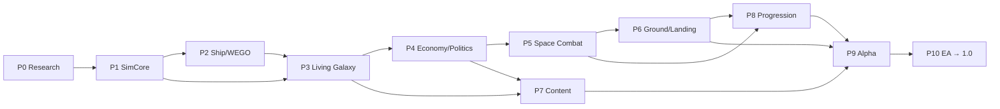

# 14. План разработки: фазы, вехи, бюджет

> **Статус:** Draft v0.3 · **Владелец:** Producer + Creative Director · **Зависит от:** [00 Видение](00-vision.md), [01 Канон](01-canon.md) (раздел 21), [21 Канон мира](21-world-canon.md), [22 Антагонист](22-antagonist.md), [23 Кампания](23-story-campaign.md), [15 MVP](15-mvp-vertical-slice.md) · **Обновлено:** 2026-10-26

## 1. Принципы планирования

План построен так, чтобы замысел **развивался, а не деградировал**: каждая фаза добавляет глубину к уже работающему ядру, а не латает дыры.

1. **Always playable.** С M10 (первый билд) игра запускается и играется. Нет фазы, которая заканчивается «серым экраном и красивым кодом».
2. **Physics first.** Фазы 0–1 — фундамент; любая система, которая требует сломать физику, помечается как «space opera допущение» и получает цену.
3. **Vertical slice на 16-м месяце.** К M16 есть 60–90-минутный срез всей игры: полёт, прыжок, торговля, бой, посадка, последствие. Он публично показывается и собирает обратную связь.
4. **Инструменты раньше контента.** Ни одна фаза контента не начинается, пока нет пайплайна и редактора (см. [13](13-content-pipeline-devops.md)).
5. **Гейты, а не даты.** Фаза закрывается по измеримому Definition of Done, а не по календарю. Дата сдвигается, объём — только через формальную процедуру (раздел 9).
6. **Глубина важнее объёма.** При нехватке времени режем количество систем/миссий/POI, но не системы: физику, экономику, репутацию, корабль.
7. **Контент-пайплайн с M12.** К моменту, когда нужны 400 систем, инструменты уже год как работают.
8. **Долгосрочная совместимость сохранений.** С M16 каждое сохранение имеет версию схемы и миграции; ломать сейвы можно только между крупными вехами и с конвертером.

## 2. Обзор фаз

| Фаза | Месяцы | Даты | Цель | Ключевой результат | FTE |
|---|---|---|---|---|---|
| **P0. Research & Prototyping** | M0–M4 | ноя 2026 — мар 2027 | доказать рискованные гипотезы | «Орбитальный плейграунд» + канон v1 + ADR по движку | 5 |
| **P1. Simulation Core** | M4–M10 | мар 2027 — сен 2027 | детерминированное ядро и генерация | 2 500 систем, N-body, события, save/load, песочница | 7 |
| **P2. Ship, WEGO, Interstellar** | M10–M16 | сен 2027 — мар 2028 | корабль, прыжок, день, карта | **Вертикальный срез M16** | 8 |
| **P3. Living Galaxy v1** | M16–M24 | мар 2028 — ноя 2028 | 64 цивилизации, технологии, экономика v1 | «Живая галактика»: 50 лет истории за 5 минут | 9 |
| **P4. Economy Depth & Politics** | M24–M29 | ноя 2028 — апр 2029 | рынок, кризисы, дипломатия, войны | экономические каскады и политика из симуляции | 9 |
| **P5. Space Combat** | M29–M35 | апр 2029 — окт 2029 | полный космический бой | 20 шаблонов энкаунтеров, обломки, салваж | 9 |
| **P6. Ground & Landing** | M35–M41 | окт 2029 — апр 2030 | посадка, поверхность, наземный бой | изометрия с полной разрушаемостью | 10 |
| **P7. Content & Narrative** | M24–M42 | ноя 2028 — май 2030 | 400 знаковых систем, 3 акта | контент-лок | 6 доп. |
| **P8. Progression Integration** | M38–M42 | фев 2030 — май 2030 | чертежи, крафт, кривые прогресса | 3 играбельных стиля, 60 ч без тупиков | 4 доп. |
| **P9. Alpha** | M42–M45 | май 2030 — авг 2030 | feature complete, стабильность | альфа-билд, EA-подготовка | 10 |
| **P10. Early Access** | M45–M51 | авг 2030 — фев 2031 | контент 100%, баланс, полировка | **1.0** | 11 |
| **P11. Post-launch** | M51+ | 2031+ | аддоны и поддержка | 2 расширения за 2 года | 8–10 |

## 3. Критический путь и зависимости

Критический путь: **P0 → P1 → P2 → P3 → P4 → P5 → P6 → P9 → P10**. Любая задержка P1 или P2 сдвигает релиз на столько же. Контент (P7) и прогрессия (P8) идут параллельно и могут «догонять» без сдвига 1.0 — но только до контент-лока M42.

**Точки невозврата:**

| Точка | Месяц | Решение | Цена ошибки |
|---|---|---|---|
| ADR по движку | M3 | Unity 6 LTS или UE5 | смена после M12 = +6–9 мес |
| Вертикальный срез | M16 | продолжать / менять формат | остановка проекта = потеря $1,2M |
| Контент-лок | M42 | объём мира зафиксирован | сдвиг 1.0 на 3–6 мес |
| EA | M45 | публичный запуск | репутационный риск |

## 4. Фазы детально

### P0. Research & Prototyping (M0–M4, 5 FTE)

**Цель:** снять главные технические и дизайнерские риски до найма основной команды.

**Содержание:**
- Три параллельных прототипа: (а) орбитальная динамика на Python/NumPy — 8 тел, 10 000 лет, проверка стабильности; (б) экономика на Python — 64 агента, 100 лет, проверка отсутствия взрывов и вырождения; (в) бумажный прототип WEGO-дня (карточки, 3 плейтеста).
- Сравнение движков по матрице из [02](02-toolchain.md); ADR-001 «Движок».
- Черновик канона v1, арт-библия (moodboard, палитра, язык форм), технический риск-лист.
- Найм лида-программиста и физпрограммиста, план найма до M10.
- Публичный devlog #1 (осторожно, без обещаний дат).

**Definition of Done:**
- 8 тел, 10 000 лет, ошибка по большой полуоси < 1%, нет NaN.
- 64 экономических агента, 100 лет моделирования < 60 с, инфляция в коридоре 0,5–6%.
- Бумажный WEGO: 3 плейтеста, ≥ 60% тестеров понимают цикл «план → день → отчёт» без объяснений.
- ADR-001 и ADR-002 (SimCore) подписаны.
- «Орбитальный плейграунд» собирается и запускается как отдельный билд (пусть даже без графики).

**Чего НЕ делаем:** сюжет, арт-ассеты в продакшене, найм художников, публичные даты.

### P1. Simulation Core & Playground (M4–M10, 7 FTE)

**Цель:** детерминированное ядро, генерация мира, физика и «песочница» — фундамент всей игры.

**Содержание:**
- `Engram.Sim` на .NET 8: тики L0, планировщик событий, RNG-потоки, ECS-модель данных, сериализация.
- Генерация 2 500 систем и ~21 000 тел: спектры звёзд, орбиты с проверкой устойчивости, пояса, ресурсы, обитаемость.
- Интеграторы WHFast/IAS15, столкновения и фрагментация, эфемериды вне bubble, активация систем.
- События: сверхновые, сближения, разрушения, миграции; очередь событий на годы вперёд.
- Unity-презентация системы: изометрия, звёздное поле, базовые шейдеры, камера, селекция.
- **Плейграунд** — отдельный режим/инструмент: запуск планет, столкновения, сверхновые, ЧД, «швырнуть планету в соседнюю систему» (через редактор, позже — в игре).
- Сохранение/загрузка, golden-hash тесты, SimLab-прогон 1 000 лет.

**Definition of Done:**
- 2 500 систем генерируются < 120 с, повторяемо по seed, хеш состояния совпадает.
- 500 тел в активной системе — 60 FPS на целевом ПК; тик L0 ≤ 20 мс.
- Соударение: сохранение импульса и энергии ±1%; 10⁶ тело-тиков без NaN/взрыва.
- Сверхновая корректно влияет на соседнюю систему; событие видно в логе.
- «Швырнуть планету» работает: планета покидает систему, летит по баллистике, сталкивается с целью.
- 10-летний прогон L0 воспроизводится побитово на одной платформе.

**Чего НЕ делаем:** корабль игрока, экономика, бой.

### P2. Ship, WEGO, Interstellar (M10–M16, 8 FTE) → **Вертикальный срез**

**Цель:** собрать 60–90 минут игры целиком и проверить, что цикл «рейнджер в живой галактике» работает.

**Содержание:**
- Корабль «Странник»: ньютоновская динамика с ассистом, субсвет, Сдвиг, топливо, износ, ремонт.
- WEGO-день: планировщик, разрешение, отчёт, авто-паузы; скорости 0,25×–40×.
- Карта галактики: коридоры, маршруты, топливо/дальность, «живая карта» с базовыми данными.
- Стартовая система с ручным контентом + 3 системы-соседа; базовый рынок (8 ресурсов, 1 хаб); 3 цивилизации-заглушки с репутацией.
- **Сюжетный крючок вертикального среза:** амнезия и «сбой восстановления» на входе; первые откровения **R1** (смерть и пересборка) и **R2** (корпус — наниты; вычисления и материя) встроены в геймплей, а не в кат-сцену; в поясе Геба-3 — странный сигнал; в финале среза — слух о **«стеклянных мирах»** и первый след Тверди ([21](21-world-canon.md), разделы 5, 8; [23](23-story-campaign.md)). Задача крючка — не объяснить тайну, а заставить хотеть продолжения.
- Один наземный прототип: посадка, космопорт, 1 миссия в изометрии, 1 перестрелка.
- Интерьер корабля: 1 палуба, FP-прогулка, терминал.
- Сохранение/загрузка, настройки, геймпад, звук-заглушки.
- Плейтесты: 15 внешних тестеров, 3 сессии, сбор телеметрии.

**Definition of Done (гейт проекта):**
- 60–90 мин непрерывной сессии без блокеров: полёт → прыжок (3 системы) → торговля → бой → посадка → миссия → последствие (новость/репутация).
- Crash rate < 1 на 2 часа; время загрузки ≤ 20 с.
- ≥ 60% тестеров хотят продолжить после среза; ≥ 40% описывают историю, случившуюся в симуляции; **≥ 70% формулируют хотя бы один вопрос о том, что произошло** ([15](15-mvp-vertical-slice.md), критерии успеха).
- Срез показывается публично (devlog/демо для прессы) — решение о продолжении финансирования.

### P3. Living Galaxy v1 (M16–M24, 9 FTE)

**Цель:** галактика начинает жить сама: цивилизации, технологии, экспансия, экономика v1.

**Содержание:**
- 64 крупные цивилизации + 210 малых фракций, 22 вида, 6 типов правительств.
- 320 техноузлов, 6 эпох, прирост RP, случайные прорывы, диффузия.
- Экономика v1: 36 ресурсов, производственные цепочки, 64 хаба, маршруты, базовое ценообразование.
- Экспансия и колонизация; флоты как абстракция; войны-заглушки (без полного боя).
- Генератор новостей из событий; досье игрока v1.
- **Реликты Эхо v1 («стеклянные иглы»):** 40 узлов сдерживания ранних семян Тверди как POI ([01](01-canon.md), 6.6; [21](21-world-canon.md), раздел 7) — археология, предупреждения, технологии карантина; первые слухи о **Тверди** и события `SeedFound`.
- **Твердь v0:** семена, конверсионные фронты и слухи о «стеклянных мирах» без полного контакта ([07](07-civilizations-tech-politics.md), раздел 17; [21](21-world-canon.md), раздел 8) — чтобы к P7 угроза росла из уже работающей симуляции.
- 100 знаковых систем + 2 100 процедурных; POI 100 типов.
- SimLab: прогон 100 лет, отчёты, поиск аномалий.

**Definition of Done:**
- 50 игровых лет симулируются за ≤ 5 мин реального времени (без игрока).
- Нет «мёртвой» галактики: за 50 лет ≥ 20 войн/конфликтов, ≥ 5 технологических прорывов, ≥ 30 новых колоний.
- Нет вырождения: ни одна цивилизация не захватывает > 25% систем без сопротивления; инфляция в коридоре.
- 10 убедительных новостных историй, сгенерированных из лога (проверяет нарративный лид).
- Контент: 100 систем играбельны, 100 POI.

### P4. Economy Depth & Politics (M24–M29, 9 FTE)

**Цель:** экономика становится политикой; сделка игрока меняет историю.

**Содержание:**
- Полная модель рынка: ордербуки, глубина, влияние сделки, восстановление цены; банки, кредит, ставки, инфляция.
- 6 типов кризисов, включая перепроизводство, с каскадами и новостями.
- Дипломатия: 64×64 отношения, договоры, галактический совет, санкции, эмбарго.
- Модель решения о войне из дефицита/экспансии/репутации; военная экономика и блокады.
- Репутация: 5 осей, Threat Index, 10 ступеней реакции, лицензии, трибунал, награды за голову.
- 200 знаковых систем; +100 типов POI.

**Definition of Done:**
- Автотест «потоп рынка»: продажа 20% годового потребления → цена −8…−25% за 5 дней → кризис отрасли → политическая реакция (эмбарго/война/национализация) в течение 5–60 дней. Проходит на 3 разных цивилизациях.
- Инфляция у 90% цивилизаций в коридоре 1–4% на горизонте 100 лет (ручная политика ЦБ работает).
- Войны: 1 на 15–25 лет на цивилизацию; 60% конфликтов разрешаются дипломатией до стрельбы.
- Награда за голову и охота на игрока работают end-to-end.

### P5. Space Combat (M29–M35, 9 FTE)

**Цель:** бой в космосе — полноценная система, а не мини-игра.

**Содержание:**
- 6 классов оружия, 4 слоя щитов, 4 брони, 8 подсистем, тепло/энергия, РЭБ, дроны.
- Модель урона: пробитие, угол, компоненты, разрушение корабля на обломки.
- Поля обломков («Пепел»): 50–5 000 объектов, урон, время жизни, сканирование и салваж, чертежи и данные.
- ИИ боя 5 уровней, 20 шаблонов энкаунтеров, орбитальные станции, абордаж (решение по итогам прототипа).
- Управление, изометрическая читаемость, slow-mo, тактические приказы.
- Интеграция с WEGO: бой как событие дня, автоматическое разрешение при отсутствии игрока.

**Definition of Done:**
- TTK 2–8 мин; ИИ выигрывает 40–60% против среднего игрока.
- 60 FPS при 5 000 обломков на экране.
- Салваж даёт компоненты/чертежи/данные; 20 энкаунтеров играбельны.
- Бой не ломает экономику: трофеи не обесценивают рынок (проверка SimLab).

### P6. Ground & Landing (M35–M41, 10 FTE)

**Цель:** планеты — полноценное пространство, а не декорация.

**Содержание:**
- Бесшовный вход в атмосферу 30–90 с, нагрев, перегрузки, выбор космопорта.
- 12 типов планет, 400 посадочных локаций, города и сервисы, 150 процедурных поселений.
- Наземный бой: SDF-разрушаемость 0,25 м, граф несущих конструкций, обрушения, 5 классов оружия, 4 брони, 20 девайсов, техника, ИИ.
- Зоны миссий 2–8 км²; 8 архетипов зон; орбитальная поддержка; терраформирование.
- Интерьер корабля: 3 палубы, виртуальные пространства, кастомизация.
- Оптимизация: стриминг, LOD, физика поверхности.

**Definition of Done:**
- Разрушается ≥ 95% объектов зоны; обрушения не ломают навигацию.
- 60 FPS в зоне 2 км² на целевом ПК; вход/выход из атмосферы без загрузки и сбоев.
- У миссии ≥ 3 путей решения (штурм, скрытность, переговоры/техника).
- Терраформирование видно на горизонте лет; изменения сохраняются.

### P7. Content & Narrative (M24–M42, 6 доп. FTE: сценаристы, миссион-дизайнеры, художники)

**Цель:** 400 знаковых систем, 3 акта, 200 побочных историй — мир, который интересно исследовать 1 000 часов.

**Содержание:**
- Сюжет: **3 акта** («Пробуждение» 1–10 ч, «Ковчег» 10–30 ч, «Грань» 30–50 ч; эпилог — до 60 ч суммарно), **9 откровений R1–R9**, **6 концовок** («Дом», «Приют», «Карантин», «Сшивка», «Свидетель», «Рассеяние»), 40–60 ч основной линии ([01](01-canon.md), разделы 21.6–21.7; [23](23-story-campaign.md)).
- **40 реликтов Эхо** — «стеклянные иглы», узлы сдерживания ранних семян Тверди, а не лут-контейнеры; линия археолога Эхо и первые «стеклянные миры».
- **Твердь и Приют:** конверсионные фронты, «стеклянные» планеты, Голос Приюта и Сеятели; ветки присоединения/борьбы ([22](22-antagonist.md), [23](23-story-campaign.md)).
- **Оцифровка миров:** добровольная и принудительная, порог **10⁶ активных энграмм**, «рынок спасения» и страх «нового Синхрона» ([01](01-canon.md), 21.3; [21](21-world-canon.md), раздел 6).
- Арки фракций: по 2–4 квестовые линии на 20 ключевых цивилизаций; «культы Приюта» и «Хранители реликтов».
- 200 побочных историй, 12 типов миссий, 300 типов POI, 150+ ключевых персонажей.
- 400 знаковых систем с ручным контентом; уникальные достопримечательности.
- Кодекс/энциклопедия, лор-тексты, новостные шаблоны.
- Локализация RU/EN с M36, вычитка с M40.

**Definition of Done:**
- Сюжет проходим от начала до конца; 40–60 ч; все 9 откровений выдаются в фиксированном порядке, темп свободный.
- 400 систем играбельны и различимы; 200 побочных историй доступны; 40 «стеклянных игл» доступны.
- Оцифровка и её последствия (порог 10⁶, репутация, коллектив) работают end-to-end.
- Контент-лок M42: новые квесты только через патчи.
- Локализация EN — 100% строк, RU — 100%.

### P8. Progression Integration (M38–M42, 4 доп. FTE)

**Цель:** прогрессия игрока связывает все системы и не имеет тупиков.

**Содержание:**
- Чертежи и обратная разработка: получение → анализ → производство из редких ресурсов.
- 10 категорий модулей × 5 тиров, смена корабля, станция игрока, флот.
- Кривые прогресса, экономические стоки, награды за исследования.
- 3 играбельных стиля: торговец/инвестор, рейнджер/боевик, исследователь/археолог.
- Балансировка через SimLab и плейтесты.

**Definition of Done:**
- 60 ч прогрессии без тупиков и обязательного гринда (проверка 5 тестеров).
- 3 стиля проходят вертикальный срез с разными решениями.
- Все чертежи достижимы минимум двумя путями.

### P9. Alpha (M42–M45, 10 FTE)

**Цель:** feature complete, стабильность, подготовка EA.

**Содержание:**
- Заморозка фич; фокус на багах, производительности, удобстве.
- **Полный прогон сюжета и концовок:** все **6 концовок** («Дом», «Приют», «Карантин», «Сшивка», «Свидетель», «Рассеяние») проходятся end-to-end, все **9 откровений** выдаются, ни одна ветка Тверди и ни одна трактовка Дома не «ломается» ([01](01-canon.md), 21.6–21.7; [23](23-story-campaign.md)).
- **Тестирование темпа тайны:** ≥ 70% тестеров после 3–5 часов хотят узнать, что произошло; никто не называет подачу «непонятной»; проверка, что тайна не раскрыта раньше R1–R3 и не затянута после R7; проверка, что Больцмановская альтернатива остаётся живой до финала.
- **Тестирование оцифровки:** добровольный и принудительный пути дают разные последствия; порог 10⁶ достижим за разумное время; ни один путь не «софтлочит» концовки.
- Полный прогон всех миссий, 100-летняя симуляция без деградации.
- EA-билд, магазин, пресс-кит, трейлер, демо для фестивалей.
- Моддинг SDK 0.9.

**Definition of Done:**
- 0 блокеров, ≤ 5 критических багов; 4 часа без краша.
- 60 FPS на целевом ПК в 90% сцен; ≤ 12 ГБ ОЗУ.
- Все фичи из [15 MVP](15-mvp-vertical-slice.md) реализованы.
- **Все 6 концовок проходимы и проверены ≥ 2 тестерами каждая; метрика «хочу узнать, что произошло» ≥ 70%** ([16](16-risks.md), R-25).
- EA-страница готова, дата объявлена.

### P10. Early Access (M45–M51, 11 FTE)

**Цель:** 1.0.

**Содержание:**
- Контент до 100%: оставшиеся системы, миссии, арт.
- Баланс по телеметрии EA: экономика, бой, прогрессия, темп.
- Ежемесячные патчи, 2 крупных обновления контента.
- Локализации DE/FR/ES/PL/ZH (по спросу).
- Моддинг SDK 1.0, Steam Workshop.
- Полировка, доступность, геймпад, Steam Deck.

**Definition of Done (1.0):**
- Все критерии из [00. Видение](00-vision.md) раздел 9.
- Steam: ≥ 85% положительных отзывов на момент релиза.
- 80+ ч основного прохождения, 1 000+ ч полного исследования.
- Сохранения EA мигрируются в 1.0.

### P11. Post-launch (M51+, 8–10 FTE)

- Аддон 1 (M57–M63): новая область галактики, 5 цивилизаций, кампания 15 ч.
- Аддон 2 (M69–M75): «Эхо» — разгадка предтеч, эндгейм-механики.
- Бесплатные патчи: моддинг, качество жизни, сезонные события.
- Консоли — только при доказанном спросе (≥ 15% запросов).

## 5. Команда по фазам (FTE)

| Роль | P0 | P1 | P2 | P3 | P4 | P5 | P6 | P7* | P8* | P9 | P10 |
|---|---|---|---|---|---|---|---|---|---|---|---|
| Creative Director / GD | 1 | 1 | 1 | 1 | 1 | 1 | 1 | 1 | 1 | 1 | 1 |
| Lead Programmer | 1 | 1 | 1 | 1 | 1 | 1 | 1 | 0 | 0 | 1 | 1 |
| Sim/Physics | 1 | 2 | 1 | 1 | 1 | 1 | 1 | 0 | 0 | 1 | 1 |
| Systems/Economy | 0 | 1 | 1 | 2 | 2 | 1 | 1 | 0 | 1 | 1 | 1 |
| Gameplay | 0 | 1 | 2 | 2 | 2 | 2 | 2 | 0 | 1 | 2 | 2 |
| Tools/Engine | 1 | 1 | 1 | 1 | 1 | 1 | 1 | 0 | 0 | 1 | 1 |
| Tech Artist | 0 | 1 | 1 | 1 | 1 | 1 | 1 | 1 | 0 | 1 | 1 |
| Environment Artist | 0 | 0 | 1 | 1 | 1 | 1 | 1 | 2 | 0 | 1 | 2 |
| Character/UI Artist | 0 | 0 | 0 | 1 | 1 | 1 | 1 | 1 | 0 | 1 | 1 |
| Narrative | 0 | 0 | 1 | 1 | 1 | 1 | 1 | 1 | 0 | 1 | 1 |
| Producer/QA Lead | 1 | 1 | 1 | 1 | 1 | 1 | 1 | 1 | 1 | 1 | 1 |
| **Итого** | **5** | **7** | **8** | **9** | **9** | **9** | **10** | **6** | **4** | **10** | **11** |

\* P7 и P8 — дополнительные люди поверх основной команды (не суммируются напрямую: artists из P7 частично те же, что в P5/P6).

**Внешние подрядчики (с M10):** 3D-ассеты (2–4 чел.), VFX (1), аудио/композитор (1–2), QA (2–3 на EA), локализация (агентство), маркетинг (агентство на EA).

## 6. Бюджет

Оценка в долларах США, средняя загруженная стоимость FTE — $11 тыс./мес. (зависит от региона).

| Статья | Сумма | Комментарий |
|---|---|---|
| Ядро команды (≈ 500 FTE-мес.) | $5,5 млн | P0–P10 |
| Внешние подрядчики | $2,0 млн | ассеты, VFX, аудио, QA, локализация |
| Инструменты и лицензии | $0,35 млн | Unity, Houdini, FMOD, CI, store |
| Маркетинг и EA-операции | $0,6 млн | трейлеры, фестивали, пресса |
| Резерв (15%) | $1,2 млн | риск-буфер |
| **Итого до 1.0** | **$9,65 млн** | рабочий диапазон $7–10 млн |

**Финансирование по этапам:**
- Посев $1,2–1,5 млн: P0–P1 (10 месяцев) + вертикальный срез.
- Раунд A / паблишер $2,5–3,5 млн: P2–P5.
- EA-доход + остаток: P6–P10. EA-план: 150 тыс. копий до 1.0 — цель, 80 тыс. — минимум для самофинансирования.

## 7. Вехи

| Веха | Месяц | Дата | Артефакт |
|---|---|---|---|
| M0 | 0 | 2026-11 | старт, канон v0.1 |
| M3 | 3 | 2027-02 | ADR по движку |
| M4 | 4 | 2027-03 | «Орбитальный плейграунд», канон v1 |
| M10 | 10 | 2027-09 | первый играбельный билд, песочница |
| M16 | 16 | 2028-03 | **вертикальный срез** |
| M24 | 24 | 2028-11 | живая галактика v1 |
| M29 | 29 | 2029-04 | экономика и политика |
| M35 | 35 | 2029-10 | космический бой |
| M41 | 41 | 2030-04 | поверхность и посадка |
| M42 | 42 | 2030-05 | **альфа, контент-лок** |
| M45 | 45 | 2030-08 | **ранний доступ** |
| M51 | 51 | 2031-02 | **1.0** |
| M63 | 63 | 2032-02 | аддон 1 |
| M75 | 75 | 2033-02 | аддон 2 |

## 8. Гейты качества (kill criteria)

Каждая фаза проверяется по трём вопросам. Если ответ «нет» — фаза не закрыта, даже если код готов.

1. **Играбельно?** Билд запускается, 30 минут играются без блокеров.
2. **Работает по канону?** Числа совпадают с [01](01-canon.md), либо канон обновлён через ADR.
3. **Не сломан ли замысел?** Новая система не отменяет столпы и не требует «срезать» уже сделанное.

**Что запрещено сокращать (protect list):** физика орбит и столкновений, экономика как причинность, репутация, WEGO-цикл, корабль-датацентр, Эхо, **сюжетная тайна: существование Дома / Больцмановская альтернатива, 9 откровений R1–R9 и 6 концовок**.

**Что можно сокращать (cut list):** количество процедурных систем, число POI, число языков, консоли, абордаж, мультиплеер, кинематографичность.

## 9. Управление изменениями

- Любая новая фича проходит **design review** (Creative Director + лид) и получает запись в `docs/features/`.
- Оценка: ≤ 2 недель — берём в текущую фазу; > 2 недель — в бэклог следующей вехи.
- **Debt ledger:** ≤ 20% спринта на техдолг; долг старше 2 фаз — блокер гейта.
- **Change freeze** за 8 недель до вехи; исключения — только критичные баги.
- Каждые 8 недель — плейтест с внешними тестерами (с M10).
- Каждый месяц — отчёт: статус, сдвиги, сожжённый бюджет, риски.

## 10. Сценарии масштабирования

| Сценарий | Команда | Срок до 1.0 | Что меняется |
|---|---|---|---|
| Малая студия | 4–5 FTE + подрядчики | 7–8 лет | режем до 1 200 систем, 24 цивилизаций, 2 актов; EA позже |
| Базовая | 11 FTE | 4,25 года | план выше |
| Усиленная | 18–22 FTE | 3–3,5 года | параллельные P5/P6, больше контента, 2 команды контента |

Малый сценарий — не «урезанная копия», а другой баланс: меньше мира, глубже отдельные системы (больше ручного контента на систему). Он описан в [15](15-mvp-vertical-slice.md).

## 11. Как план защищает замысел от деградации

1. **Фундамент раньше фич:** физика и ядро (P0–P1) не переписываются под фичи.
2. **Вертикальный срез как контракт:** если после M16 фича не улучшает срез — она не нужна.
3. **Protect list:** ключевые системы нельзя вырезать без публичного пересмотра видения.
4. **Канон как закон:** числа меняются через ADR, а не «по ходу».
5. **Контент после инструментов:** нет «рукописных» систем, которые потом нельзя поддержать.
6. **SimLab с M12:** экономика и войны балансируются прогонами, а не мнением.
7. **Открытая разработка:** devlog, плейтесты, EA — внешняя проверка, что игра не «съехала».
8. **Пост-релизные аддоны** расширяют, а не перезапускают: новые регионы, виды, механики поверх ядра.

## 12. Открытые вопросы

1. Нужен ли публичный демо-билд на M16 или достаточно закрытого среза + трейлера?
2. Источник финансирования: паблишер или EA-самофинансирование (влияет на даты M29–M35).
3. Абордаж: полноценная механика или скриптовые события? Решение после P5.
4. Консоли: закладывать управление с P2 или после 1.0?
5. Нужна ли отдельная команда «живого мира» (2 человека), поддерживающая баланс после 1.0?
